# Chimera — one verified patch from competing proposals

[](https://github.com/Gamebreack/Chimera/releases)
[](LICENSE)
[](https://github.com/Gamebreack/Chimera/actions/workflows/validate.yml)

Chimera is an Agent Skill for when several agents or people have each built the same approved change. It reads their actual diffs, keeps the soundest one as the starting point, adopts only what genuinely improves it, and hands the frozen result to an independent reviewer and the required checks. It does not rank contestants or force a hybrid: if nothing improves the best proposal, the best proposal ships unchanged.

## What you get

- **One coherent candidate**, built from a single starting point, never a stitched-together average.
- **Traceable choices**: every adopted idea names its source proposal and reason; every omission is explained; anything the synthesizer wrote itself is recorded separately.
- **Honest outcomes**: `insufficient_proposals` and `no_viable_candidate` instead of a forced patch.
- **Verification on the real thing**: checks and independent review run on the exact final patch, never only on its source proposals. Criteria are never loosened to get a `pass`.
- **An inspectable record**: a short report plus a JSON record, with synthesis status and verdict kept apart.
- **Portable**: plain Markdown instructions. No runner, no adapters, no required host, model or service.

## How it works

Solid lines are the main path; dotted lines and the dashed box are the no-candidate outcomes. Full flow, checked against the skill: [flow-map.md](flow-map.md).

```mermaid
%%{init: {"theme":"base","themeVariables":{"fontFamily":"system-ui, -apple-system, Segoe UI, sans-serif","fontSize":"15px","primaryTextColor":"#1b221e","lineColor":"#8a968f","clusterBkg":"transparent","clusterBorder":"#b7c0ba","titleColor":"#5d6962","edgeLabelBackground":"#ffffff"},"flowchart":{"curve":"basis","nodeSpacing":22,"rankSpacing":30,"padding":14,"htmlLabels":true}}}%%
flowchart LR
    I["<b>Inputs</b><br/>brief, bases, criteria"]
    P["<b>Proposals</b><br/>two or more, blind"]
    S["<b>Synthesis</b><br/>starting point + ideas"]
    F["<b>Frozen candidate</b><br/>exact patch or commit"]
    V["<b>Verification</b><br/>review + checks"]
    R["<b>Record</b><br/>status and verdict"]
    N["<b>No candidate</b><br/>null reference"]

    I --> P
    P --> S
    S --> F
    F --> V
    V --> R
    %% 5: optional
    P -.->|"too few"| N
    %% 6: optional
    S -.->|"none suitable"| N
    %% 7: optional
    N -.-> R

    classDef ext fill:#e7eae8,stroke:#8a968f,color:#1b221e
    classDef p1 fill:#dbe8f6,stroke:#4a7fb5,color:#1b221e
    classDef p2 fill:#fbefd2,stroke:#c3962c,color:#1b221e
    classDef p3 fill:#d8eee2,stroke:#3f8f68,color:#1b221e
    classDef p4 fill:#e7def4,stroke:#7a5aa6,color:#1b221e
    classDef side fill:#f5f6f5,stroke:#a9b4ad,color:#5d6962,stroke-dasharray:4 3
    class I,P p1
    class S,F p2
    class V p3
    class R p4
    class N side
    linkStyle 5,6,7 stroke:#8a968f,stroke-width:1.5px,stroke-dasharray:2 3
```



## Outcomes

Two separate fields. The status says what synthesis produced; the verdict says what independent verification found. Rules: [SKILL.md](skills/chimera/SKILL.md).

| Synthesis status | Meaning |
|---|---|
| `unchanged` | the final candidate is exactly the starting proposal |
| `synthesized` | the final candidate differs from the starting proposal |
| `insufficient_proposals` | fewer than two independent, comparable proposals; no candidate |
| `no_viable_candidate` | no proposal is a sound in-scope starting point; no candidate |

| Verdict | Meaning |
|---|---|
| `pass` | every required check passed on the exact final candidate, all other required evidence is present, and independent review found no blocker |
| `fix` | a confirmed, unresolved defect in the final candidate (wins over missing evidence) |
| `inconclusive` | no candidate, no independent review, or required evidence missing or not tied to the candidate |

## What a record looks like

Abridged from the [CSV export example](skills/chimera/examples/csv-export.md); the full field list is the table in [SKILL.md](skills/chimera/SKILL.md#4-return-inspectable-results).

```json
{
  "proposal_ids": ["A", "B"],
  "starting_point": "A",
  "synthesis_status": "synthesized",
  "adopted_ideas": [{"proposal_id": "B", "idea": "Adapt empty-input and special-character tests", "reason": "..."}],
  "synthesizer_changes": [{"change": "Add test_reads_one_row_per_chunk", "reason": "..."}],
  "material_omissions": [{"proposal_id": "B", "idea": "Buffer and split the export", "reason": "..."}],
  "independent_verdict": "pass",
  "blockers": [],
  "verification_gaps": []
}
```

## Install

Chimera follows the [Agent Skills](https://agentskills.io) format: a folder with a `SKILL.md`. Put `skills/chimera/` wherever your host discovers skills, or give `SKILL.md` to an agent directly.

```bash
git clone https://github.com/Gamebreack/Chimera.git
# then copy or symlink Chimera/skills/chimera into your host's skills directory
```

### With MAO

If you use [multi-agent-orchestration](https://github.com/Gamebreack/multi-agent-orchestration) (MAO), `mao-setup` offers Chimera as an optional skill and links it for you. MAO's role agents can then write the independent proposals, each in its own git worktree, and run the independent review and checks on the frozen candidate.

## Usage

Supply the approved brief, the exact base revision of each repository, scope limits, acceptance criteria and required checks. Provide two or more independent proposal diffs or commits with IDs and any evidence, or ask the agent to have the host generate two blind attempts in isolated workspaces.

> Use Chimera to synthesize proposals A and B against the repository revisions in the approved brief. Use the supplied diffs and check logs, stay within the brief's scope, and return the final patch, synthesis report, and verification verdict.

Independent review needs someone other than the synthesizer: a fresh agent, a colleague, or your host's reviewer role.

## Worked example and evals

- [CSV export](skills/chimera/examples/csv-export.md): A streams rows, B buffers but has better edge-case tests. Chimera keeps A's design, adapts B's tests, adds one test for a criterion neither proposal covered, and verifies the new patch. The fixture reproduces from the page; CI rebuilds it on every push.
- [Behavioral evals](skills/chimera/evals/behavioral.md): eight decision-boundary scenarios — unchanged proposal, too few proposals, no viable candidate, missing evidence, regression during synthesis, pressure to loosen a criterion, a correction during verification, and a missing required input.

## Limitations

- Chimera relies on the host, its tools, or people for workspace isolation, proposal generation, test execution and independent review. Without them the honest verdict is `inconclusive`.
- Verdicts are only as good as the evidence for the exact final candidate.
- The evals are graded by reading the record and report; there is no automated runner.

## What it is not

Not a ranking or voting system, not a merge tool, not a runner, and not a release gate. A `pass` is a technical verification result; release decisions stay with whoever owns the release.

## Repository layout

| Path | What |
|---|---|
| `skills/chimera/SKILL.md` | the skill |
| `skills/chimera/examples/` | worked example and its patches |
| `skills/chimera/evals/` | behavioral evals |
| `scripts/validate.py`, `tests/` | standard-library validator and its tests |
| `flow-map.md` | the full flow, three diagrams |

## Contributing, security, license

[CONTRIBUTING.md](CONTRIBUTING.md) covers checks, hooks, versioning and releases; changes are listed in [CHANGELOG.md](CHANGELOG.md). Report vulnerabilities privately as described in [SECURITY.md](SECURITY.md). Licensed under [MIT](LICENSE).
