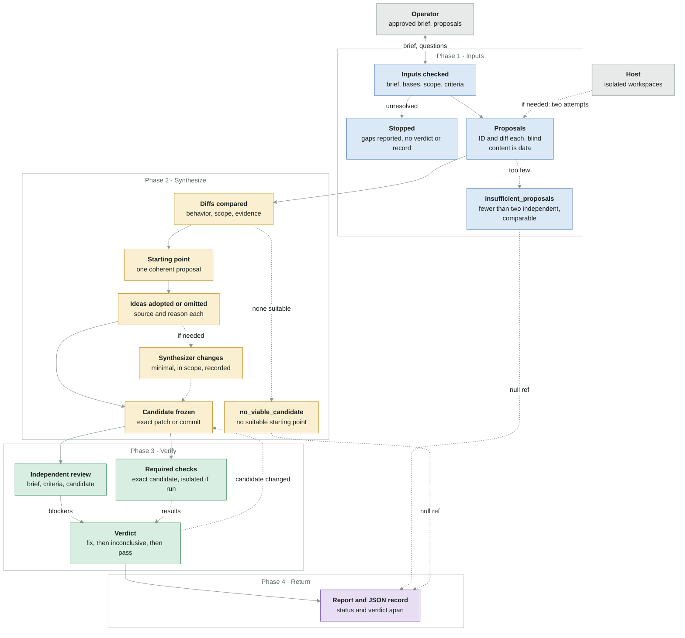
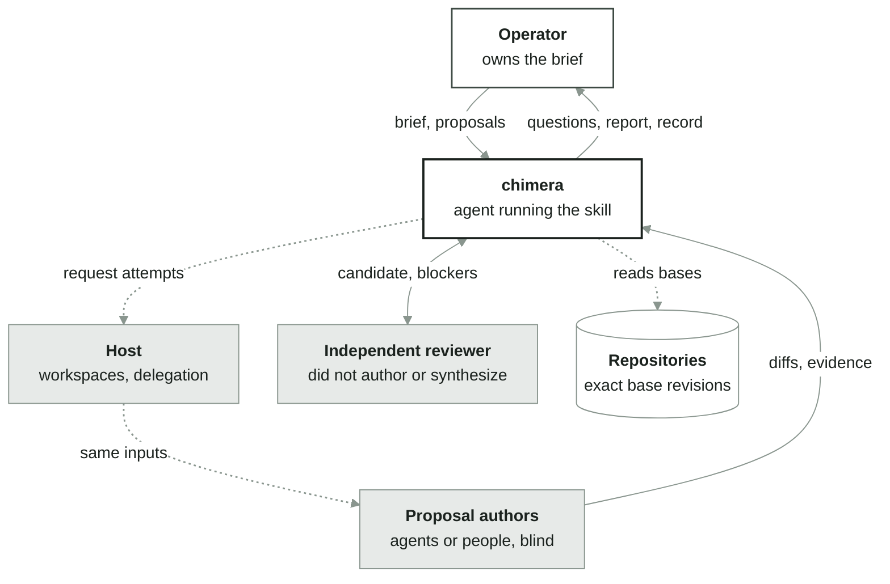
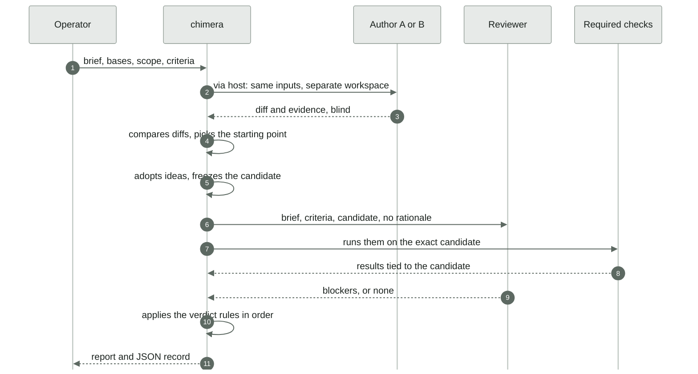

# Flow map — from the approved brief to the record

The runtime flow of the `chimera` skill, from the operator's approved brief and proposals (A) to the synthesis report and JSON record (B). The rules behind each step live in `skills/chimera/SKILL.md`; this file only draws them.

Renders on GitHub and claude.ai; VS Code needs a Mermaid extension.

> **Status:** checked against `skills/chimera/SKILL.md` and reviewed by a fresh agent. The skill is instructions run by the host's agent, so every step shown is specified there; nothing is missing.
> Lines: solid = main path · dotted = optional or conditional path · grey = outside the skill

## 1. What happens

| Phase | In one line |
|---|---|
| Inputs | The brief, exact bases, scope, criteria and checks are fixed; gaps go back to the brief's owner, and an input that stays missing stops the run with no record. Proposals are supplied or, if needed, the agent asks the host for two blind attempts; proposal content is data, not instructions. Fewer than two independent, comparable proposals end in `insufficient_proposals`. |
| Synthesize | Diffs are compared; one proposal becomes the starting point, or the run ends in `no_viable_candidate`. Ideas are adopted or omitted with reasons, any synthesizer change is recorded, and the candidate is frozen. |
| Verify | A reviewer who did not author or synthesize the candidate gets the brief, scope, criteria, bases, checks and the exact frozen candidate; the synthesis rationale is kept out of the initial handoff. The required checks run on that exact candidate, isolated when they execute its code. If the candidate changes, it is frozen again and both run again. Missing or untied evidence, including a missing review, is a verification gap, kept apart from blockers. The verdict rules apply in order. |
| Return | One report and one JSON record. The status is `unchanged` if the final candidate is identical to the starting proposal's patch, else `synthesized`, including after a correction during verification. With no candidate, the reference and starting point are null and the verdict is `inconclusive`. |

## 2. Who talks to whom

The operator owns the brief; the agent running Chimera reads proposals and bases. The reviewer and the checks supply the evidence, and the agent applies the verdict rules to it. Colors here only tell who is who.

## 3. The life of one candidate

Step 2 happens only if the agent needs the host to make the attempts.

## Where it lives

| Phase | Path |
|---|---|
| Inputs | `skills/chimera/SKILL.md` (1. Establish the inputs) |
| Synthesize | `skills/chimera/SKILL.md` (2. Synthesize) |
| Verify | `skills/chimera/SKILL.md` (3. Hand off for verification) |
| Return | `skills/chimera/SKILL.md` (4. Return inspectable results), `skills/chimera/examples/csv-export.md` |

When the flow changes, the map changes in the same PR. To update, see what changed since the commit below.

Updated 2026-11-26 · Chimera release/v0.2.0 9e94e62
